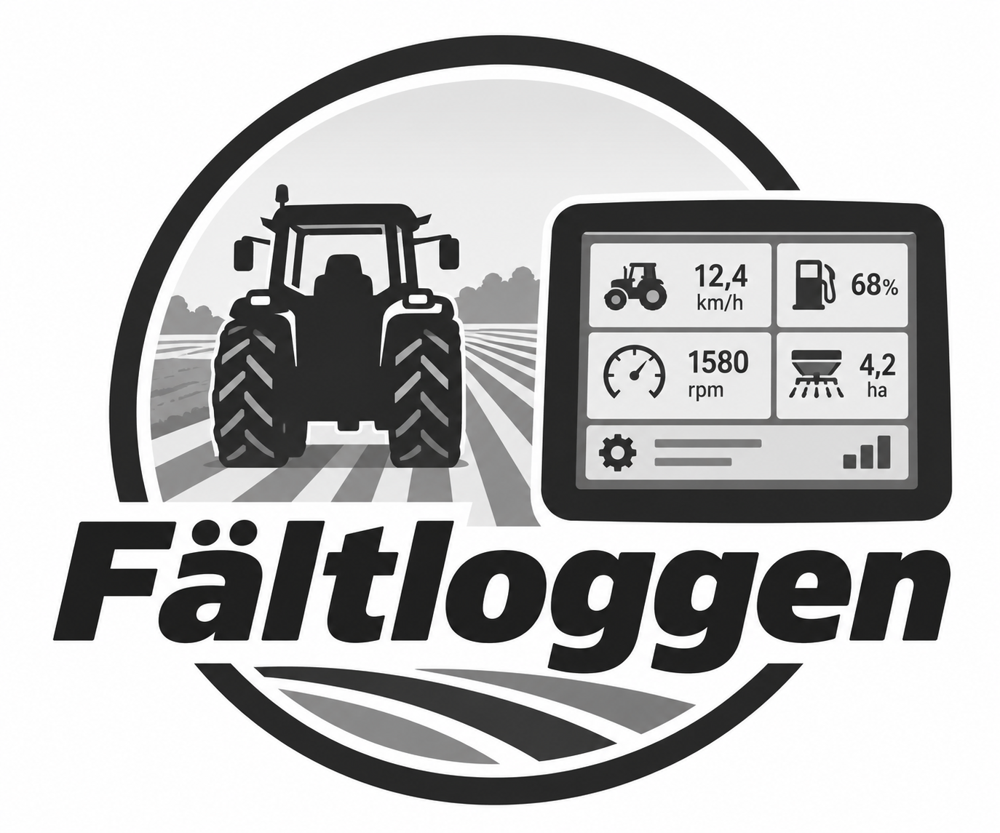
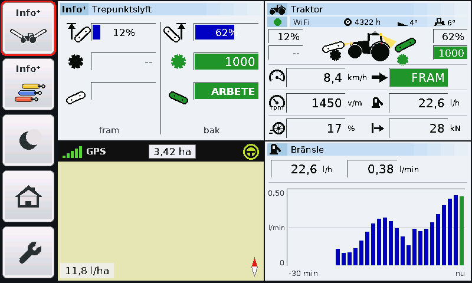

<p align="center"></p>

# Fältloggen

**En extra skärm för traktorhytten som lyssnar på ISOBUS** – byggd av en lantbrukare på fritiden och delad
gratis med kollegor. *English: see [README_EN.md](README_EN.md).*

Fältloggen kopplas till hyttens ISOBUS-uttag och visar traktorns egna data på en 7-tums pekskärm:
hastighet, motorvarv, kraftuttag, lyft, hydraulventiler, bränsle, **slirning**, dragkraft, lutning och
belysning – plus en **karta** med körd areal, en **bränsle- och kostnadsanalys** och en **fältrapport som
PDF** direkt till telefonen. Den visar också ISOBUS-redskapets värden och kan **spegla redskapets egen
bild** från traktorns terminal.

Skärmen **lyssnar bara**. Den skickar aldrig något på bussen och kan inte styra traktorn eller redskapet.

> **Viktigt – läs först**
> - Fältloggen är **byggd helt utan inblandning från Fendt, AGCO eller någon annan tillverkare** och är
>   inte godkänd, granskad eller stödd av dem. Fendt, AGCO, Vario och ISOBUS är varumärken som tillhör sina
>   ägare och nämns bara för att beskriva vad skärmen fungerar med.
> - Allt levereras **i befintligt skick, utan garanti**. Att bygga, ansluta, uppdatera och använda
>   Fältloggen sker **helt på eget ansvar**.
> - Provad på **Fendt 720 och 828 Vario S4**. Andra traktorer kan skicka andra saker (det som inte hörs
>   visas som "--").
> - Frågor och feedback besvaras **i mån av tid** – det finns ingen support.

<p align="center"></p>

**Bilder på alla sidor:** [SKARMBILDER.md](SKARMBILDER.md)

## Innehåll

- [Vad den visar](#vad-den-visar)
- [Inköpslista](#inköpslista)
- [Bygga](#bygga)
- [Installera programmet](#installera-programmet)
- [Första start och inställningar](#första-start-och-inställningar)
- [Uppdateringar](#uppdateringar)
- [Feedback](#feedback)
- [Integritet](#integritet)
- [Licenser](#licenser)
- [För utvecklare](#för-utvecklare)

## Vad den visar

| Sida | Innehåll |
|---|---|
| **Traktor** | Lyft fram/bak, kraftuttag, hastighet, körriktning, motorvarv, bränsle l/h, slirning, dragkraft, lutning, lampor, hydraulventiler |
| **Karta** | Körd yta på satellitbild, areal (överlapp räknas en gång), bränsle per hektar, spåret färgat efter bränsle/dragkraft/slirning, skiftets areal och beräknad klar-tid |
| **Fältrapport** | PDF med tre kartor och statistik, hämtas med telefonen via skärmens eget WiFi (fungerar utan internet) |
| **Bränsleanalys** | Kostnad per hektar vid olika hastighet de senaste 30 minuterna, med rekommendation |
| **Redskap** | Värden från ISOBUS-redskapet med redskapets egna namn och enheter |
| **TERMINAL** | Redskapets egen bild som på traktorns terminal (bara visning) |

Svenska och engelska, dag- och nattläge, inbyggd manual (Inställningar → MANUAL) och demoläge.
Hela manualen: [manual/MANUAL.md](manual/MANUAL.md).

## Inköpslista

Kontrollera priser och lagerstatus själv – de ändras.

| Del | Antal | Kommentar |
|---|---|---|
| **Waveshare ESP32-S3-Touch-LCD-7** (7", 800 × 480, ESP32-S3 med 16 MB flash och 8 MB PSRAM, CAN) | 1 | [waveshare.com](https://www.waveshare.com/esp32-s3-touch-lcd-7.htm). Det är *den* modellen programmet är skrivet för – inte "7B" eller andra storlekar. |
| microSD-kort, 32 GB | 1 | Formateras FAT32 över hela kortet. Kartbilder, spår, rapporter och (valfritt) loggar sparas här. |
| USB-C-kabel och 5 V USB-ström i hytten | 1 | Minst 1 A. Skärmen drar ca 0,5 A. |
| Kontakt till hyttens ISOBUS-uttag (in-cab, 9 poler) + två ledare | 1 | Svår att köpa – det finns en [utskrivbar plugg](hardware/README.md#isobus-plugg-utskriven-kontakt-till-hyttens-uttag). Se [Ansluta till ISOBUS](#ansluta-till-isobus). |
| M3 × 8 cylinderskruv | 4 | Håller skärmen i skalet. |
| M3-skruv för kabelklämmorna | 4 | Längd efter klämmorna, ca 8–10 mm. |
| Filament, PETG eller ASA | ca 150 g | Till skalet. PLA blir för mjukt i en varm hytt. |
| *Valfritt:* DC/DC 4–40 V → 5 V, t.ex. Electrokit EKM006 | 1 | Om du vill mata från 12 V i stället för USB. Kortet levereras på 3,3 V – bygeln måste flyttas till 5 V. |

## Bygga

### Skalet

3D-filerna finns i [hardware/](hardware/README.md). Standard är skalet i ett stycke med snabbfäste för
mobilhållaren i Fendt-hytten (`skal7s_skal.stl`). Skärmen läggs i framifrån och skruvas fast bakifrån med
4 × M3 × 8 i skärmens egna gängor. Kablarna kläms inne i skalet med två klämmor (dragavlastning).

### Kortet: byglar och USB-uttag

- **De två gula byglarna** (nere till höger, märkta 120R / NC) kopplar in ett 120 Ω-avslutningsmotstånd för
  RS-485 respektive CAN. Från fabrik sitter de på **120R**. Flytta **CAN-bygeln till NC** – traktorns buss är redan
  avslutad, och ett extra motstånd kan störa den. RS-485 används inte; den bygeln spelar ingen roll.
- **Omkopplaren UART1 / UART2** ska stå på **UART1**. Den väljer vilken av processorns serieportar som går till
  UART-uttaget; i UART1 fungerar både installationen och inställningar via kabel.
- **USB-C-uttaget märkt UART** (det övre, närmast SD-kortet) används för installationen, inställningar via kabel och
  ström i traktorn.
- **USB-C-uttaget märkt USB** (det nedre) används inte. Det delar stift med CAN, och programmet kopplar om dem till CAN.

### ISOBUS-pluggen

Riktiga kontakter till hyttens uttag är svåra att få tag på. I [hardware/](hardware/README.md#isobus-plugg-utskriven-kontakt-till-hyttens-uttag)
finns en utskrivbar plugg i tre delar (kärna, låsring och kåpa).

### Ansluta till ISOBUS

Skärmen behöver bara **CAN_H** och **CAN_L** (ISOBUS kör 250 kbit/s).

- Mät eller kontrollera med traktorns kopplingsschema vilka stift i uttaget som är CAN_H och CAN_L innan du
  ansluter något. På de provade Fendt S4-traktorerna satt **CAN_H på stift 4** och **CAN_L på stift 2** i
  hyttens 9-poliga ISOBUS-uttag – men lita inte på det för din traktor.
- Koppla CAN_H till kortets **CAN H** och CAN_L till **CAN L**.
- Bussen är redan avslutad. CAN-bygeln ska stå på **NC** (se [Kortet](#kortet-byglar-och-usb-uttag)).
- Kontakten måste sitta i botten av uttaget – glapp ger avbrott.

Skärmen arbetar i läget *listen only*: CAN-styrkretsen skickar inte ens kvittenser.

## Installera programmet

Färdiga filer finns i [firmware/](firmware/):

- `Faltloggen_vN_usb.bin` – hela programmet, för **första installationen** (skrivs på adress `0x0`).
- `Faltloggen.bin` – bara programdelen (används av uppdateringarna).

**Enklast, i webbläsaren (Chrome eller Edge på en dator):**

1. Ställ omkopplaren på **UART1** och koppla skärmen till datorn med USB-C i uttaget märkt **UART** (det övre).
2. Öppna [Espressifs flash-verktyg i webbläsaren](https://espressif.github.io/esptool-js/) och tryck
   **Connect**. Välj skärmens port.
3. Ange adress **0x0**, välj filen `Faltloggen_vN_usb.bin` och tryck **Program**. Vänta tills det är klart.
4. Tryck **reset** på kortet (eller koppla ur och in USB).

Vissa Windows-datorer behöver en USB-drivrutin för kortet. Hittas ingen port: håll in **BOOT**, tryck
**RESET**, släpp BOOT och försök igen.

**Med kommandorad:** `esptool.py --chip esp32s3 write_flash 0x0 Faltloggen_vN_usb.bin`

*Planerat:* en egen installationssida där du bara trycker INSTALLERA.

## Första start och inställningar

1. Sätt i SD-kortet (FAT32) och starta. Skärmen visar loggan och "Väntar på ISOBUS".
2. Skiftnyckeln → **Språk**, **WiFi → VÄLJ NÄT** (behövs för kartbilder och uppdateringar).
3. Prova gärna **DEMO** innan skärmen sitter i traktorn.

Fler inställningar kan läggas i `CONFIG.TXT` i SD-kortets rot (se [CONFIG.TXT.exempel](CONFIG.TXT.exempel)):

```
namn=Traktor 1
wifi1_ssid=Maskinhallen
wifi1_pass=hemligt
valuta=kr
uppdatering=PA
```

Samma rader kan skrivas via USB-kabeln (115200 baud). `visa` skriver ut inställningarna.

## Uppdateringar

Uppdateringarna är **frivilliga**. När skärmen får internet kollar den om en ny version finns här i
arkivet. Finns det en visas en ruta med ansvarstext och tre val: **JA, INSTALLERA**, **INTE NU** och
**STÄNG AV**. Ingenting installeras utan JA. Under Inställningar → MER kan uppdateringarna stängas av helt;
då kontaktar skärmen aldrig GitHub. Startar en ny version inte ordentligt går skärmen själv tillbaka.

## Feedback

Inställningar → MER → **SKICKA FEEDBACK** visar en QR-kod till
[ärendesidan](https://github.com/statsminister1-blip/faltloggen/issues). Rapportera fel, fråga och föreslå
förbättringar där. Det besvaras i mån av tid. Skriv aldrig lösenord eller annat känsligt – allt är offentligt.

## Integritet

Fältloggen skickar inga loggar, positioner eller rapporter någonstans. Med WiFi kontaktar den bara
**GitHub** (versionskoll, om uppdateringar är på) och **EOX** (kartbilder – EOX ser då vilket område
bilderna gäller). Fältrapporten hämtas med telefonen direkt från skärmen. Inspelning av bussen (Loggning)
är av som förval och sparas bara på ditt SD-kort.

## Licenser

| Vad | Licens |
|---|---|
| Programmet (`src/`, `tools/`) | **GNU GPL v3 eller senare** – [LICENSE](LICENSE) |
| Skal och ritningar (`hardware/`) | **CERN-OHL-S v2** – [LICENSES/CERN-OHL-S-2.0.txt](LICENSES/CERN-OHL-S-2.0.txt) |
| Manual och bilder (`manual/`, `bilder/`) | **CC BY-SA 4.0** – [LICENSES/CC-BY-SA-4.0.txt](LICENSES/CC-BY-SA-4.0.txt) |

Du får använda, ändra, dela och sälja Fältloggen, men den som delar eller säljer den – ändrad eller inte –
måste ge mottagaren källkoden och sina ändringar under samma licens. Ingen får göra en sluten kopia.

Delar från andra: se [TREDJEPART.md](TREDJEPART.md) (QR-kodbiblioteket, grafikbiblioteken, typsnittet,
ESP32-kärnan och kartbilden).

## För utvecklare

Bygginstruktioner, de två ändringarna i grafikbiblioteket och hur sidorna ritas på datorn står i
[UTVECKLING.md](UTVECKLING.md). Förbättringar tas gärna emot som pull requests, men de granskas i mån av tid.
