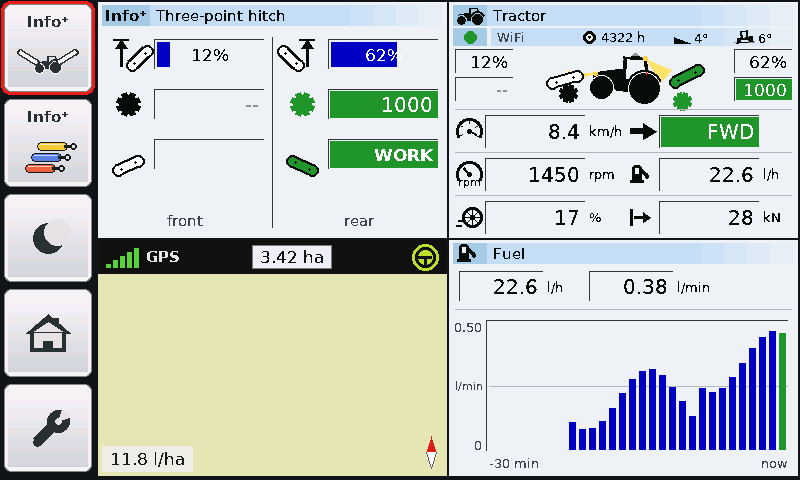

# Fältloggen

**An extra display for the tractor cab that listens to ISOBUS** – made by a farmer in spare time and
shared for free with colleagues. *Svenska: se [README.md](README.md).*

Fältloggen ("the field log") connects to the cab's ISOBUS socket and shows the tractor's own data on a
7-inch touch screen: speed, engine speed, PTO, hitch, hydraulic valves, fuel, **wheel slip**, draft force,
slope and lights – plus a **map** with the area covered, a **fuel and cost analysis** and a **field report
as a PDF** straight to your phone. It also shows the ISOBUS implement's values and can **mirror the
implement's own screen** from the tractor terminal.

The display **only listens**. It never sends anything on the bus and cannot control the tractor or the implement.

> **Important – read first**
> - Fältloggen was **built entirely without involvement from Fendt, AGCO or any other manufacturer** and is
>   not approved, reviewed or supported by them. Fendt, AGCO, Vario and ISOBUS are trademarks of their
>   owners and are only mentioned to describe what the display works with.
> - Everything is provided **as is, without warranty**. Building, connecting, updating and using
>   Fältloggen is **entirely at your own risk**.
> - Tested on **Fendt 720 and 828 Vario S4**. Other tractors may send other things (whatever is not heard
>   is shown as "--").
> - Questions and feedback are answered **when time allows** – there is no support.

## Parts list

Check prices and stock yourself – they change.

| Part | Qty | Note |
|---|---|---|
| **Waveshare ESP32-S3-Touch-LCD-7** (7", 800 × 480, ESP32-S3 with 16 MB flash and 8 MB PSRAM, CAN) | 1 | [waveshare.com](https://www.waveshare.com/esp32-s3-touch-lcd-7.htm). The software is written for *this* model – not "7B" or other sizes. |
| microSD card, 32 GB | 1 | Formatted FAT32 over the whole card. Map images, tracks, reports and (optional) logs are stored here. |
| USB-C cable and 5 V USB power in the cab | 1 | At least 1 A. The display draws about 0.5 A. |
| Connector for the cab ISOBUS socket (in-cab, 9 pins) + two wires | 1 | See [Connecting to ISOBUS](#connecting-to-isobus). |
| M3 × 8 socket head screw | 4 | Holds the display in the housing. |
| M3 screws for the cable clamps | 4 | About 8–10 mm. |
| Filament, PETG or ASA | approx. 150 g | For the housing. PLA gets too soft in a warm cab. |
| *Optional:* DC/DC 4–40 V → 5 V, e.g. Electrokit EKM006 | 1 | To power it from 12 V instead of USB. Ships set to 3.3 V – move the jumper to 5 V. |

## Building

**Housing:** the 3D files are in [hardware/](hardware/README.md). The standard is the one-piece housing with a
quick mount for the phone holder in the Fendt cab (`skal7s_skal.stl`).

### Connecting to ISOBUS

The display only needs **CAN_H** and **CAN_L** (ISOBUS runs at 250 kbit/s).

- Measure or check the tractor's wiring diagram for which pins in the socket are CAN_H and CAN_L before you
  connect anything. On the tested Fendt S4 tractors **CAN_H was pin 4** and **CAN_L pin 2** in the cab's
  9-pin ISOBUS socket – but do not rely on that for your tractor.
- Connect CAN_H to the board's **CAN H** and CAN_L to **CAN L**.
- The bus is already terminated. Do **not** add your own 120 Ω resistor; if the board has a termination
  jumper it must be off.
- Check the board's jumpers against [Waveshare's wiki](https://www.waveshare.com/wiki/ESP32-S3-Touch-LCD-7)
  so that the CAN part is connected.
- The plug must sit fully home in the socket – a loose plug gives dropouts.

The display works in *listen only* mode: the CAN controller does not even send acknowledgements.

## Installing the software

Ready-made files are in [firmware/](firmware/): `Faltloggen_vN_usb.bin` is the complete image for the
**first installation** (written at address `0x0`); `Faltloggen.bin` is the app only (used by updates).

1. Connect the display to a computer with USB-C.
2. Open [Espressif's web flasher](https://espressif.github.io/esptool-js/) in Chrome or Edge and press **Connect**.
3. Address **0x0**, choose `Faltloggen_vN_usb.bin`, press **Program** and wait.
4. Press **reset** on the board.

If no port shows up: hold **BOOT**, press **RESET**, release BOOT and try again.
Command line: `esptool.py --chip esp32s3 write_flash 0x0 Faltloggen_vN_usb.bin`

## First start

Insert the SD card, start, then spanner → **Language → ENGLISH** and **WiFi → CHOOSE**. Try **DEMO** before
fitting it in the tractor. More settings can go in `CONFIG.TXT` on the SD card – see
[CONFIG.TXT.exempel](CONFIG.TXT.exempel).

## Updates, feedback and privacy

- **Updates are optional.** When a new version is published here, the display shows a box with a liability
  text: **YES, INSTALL**, **NOT NOW** or **TURN OFF**. Nothing is installed without YES. Settings → MORE can
  turn updates off completely.
- **Feedback:** Settings → MORE → **SEND FEEDBACK** shows a QR code to the
  [issues page](https://github.com/statsminister1-blip/faltloggen/issues). Answered when time allows.
- **Privacy:** Fältloggen sends no logs, positions or reports anywhere. With WiFi it only contacts GitHub
  (version check, if updates are on) and EOX (map images).

## Licences

The software is **GNU GPL v3 or later** ([LICENSE](LICENSE)), the housings **CERN-OHL-S v2**, the manual and
pictures **CC BY-SA 4.0**. You may use, change, share and sell Fältloggen, but whoever shares or sells it –
changed or not – must pass on the source code and their changes under the same licence. Third-party parts:
[TREDJEPART.md](TREDJEPART.md). Developer notes (in Swedish): [UTVECKLING.md](UTVECKLING.md).
