# Fältloggen – screenshots

*Svenska: [SKARMBILDER.md](SKARMBILDER.md)*

All pictures are drawn by the display's own drawing code on a computer (`tools/vt/pc`), with made-up values. The terminal mirror (TERMINAL) is not shown, since it shows the implement maker's own graphics.

## Start screen

Shown for a few seconds at power-on.

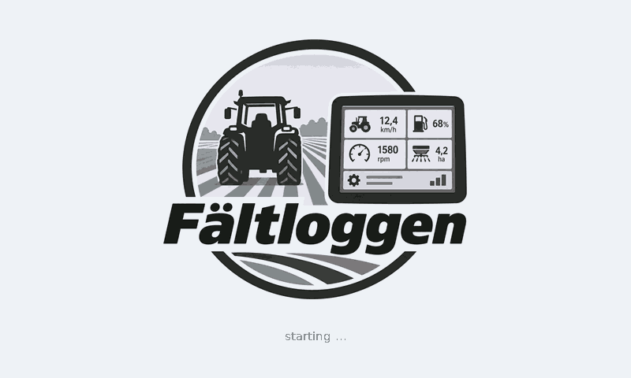

## Idle

When nothing is heard on ISOBUS. The spanner opens the settings.

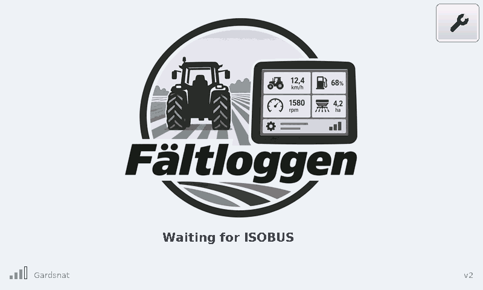

## Start choice

When an ISOBUS implement is found you choose the tractor or implement page.

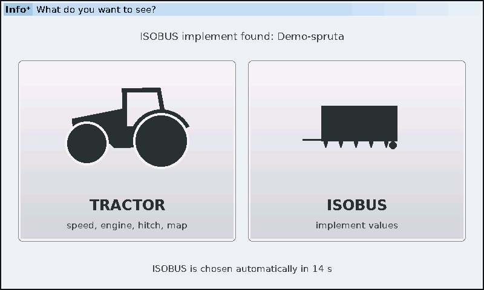

## Tractor page

Hitch, PTO, valves, speed, engine speed, fuel, wheel slip, draft force and map.

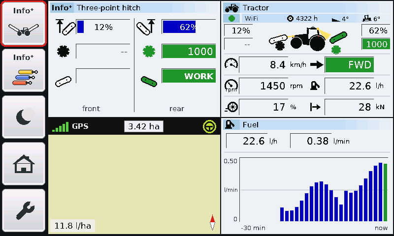

## Tractor page, night mode

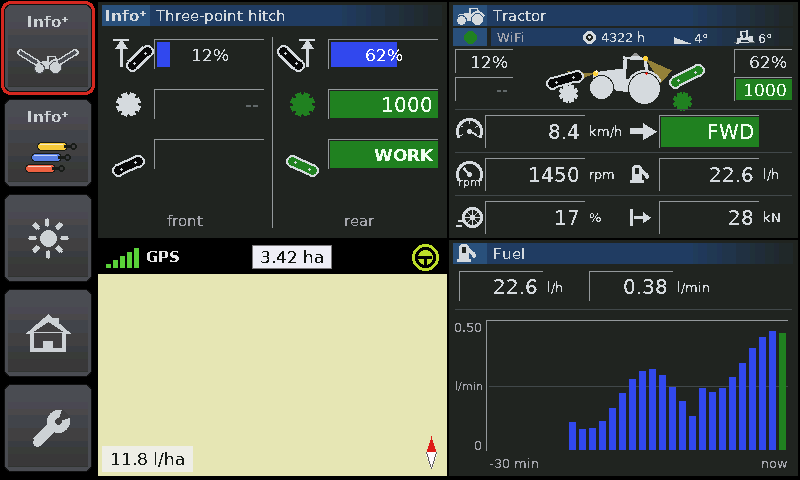

## Full-screen map

Area covered, fuel per hectare and the track coloured by fuel, draft or slip. (Shown here without the satellite image.)

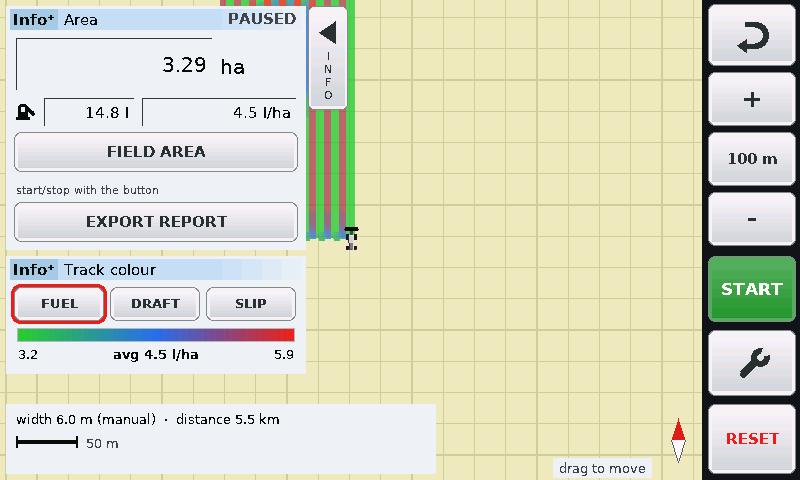

## Map with the panels hidden

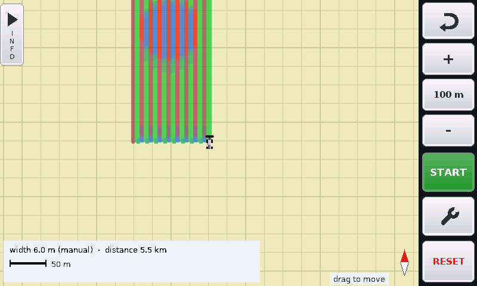

## Map settings

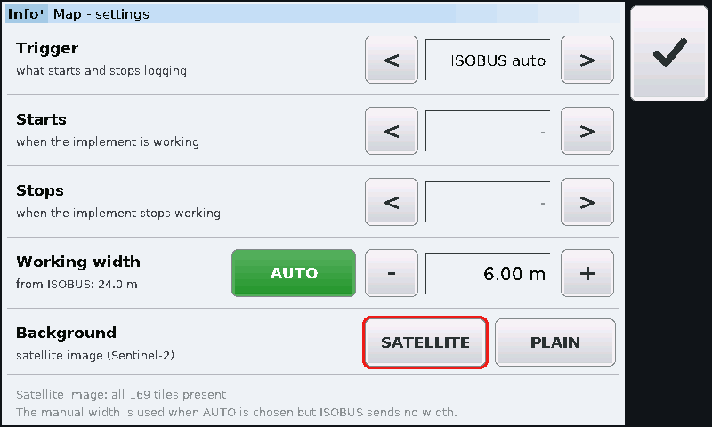

## Fuel analysis

Cost per hectare at different speeds over the last 30 minutes, with a recommendation.

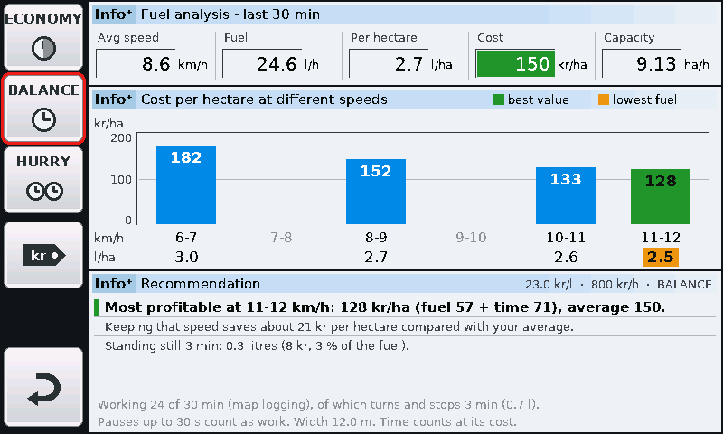

## Field report to the phone

The phone joins the display's own WiFi and downloads the report – no internet needed.

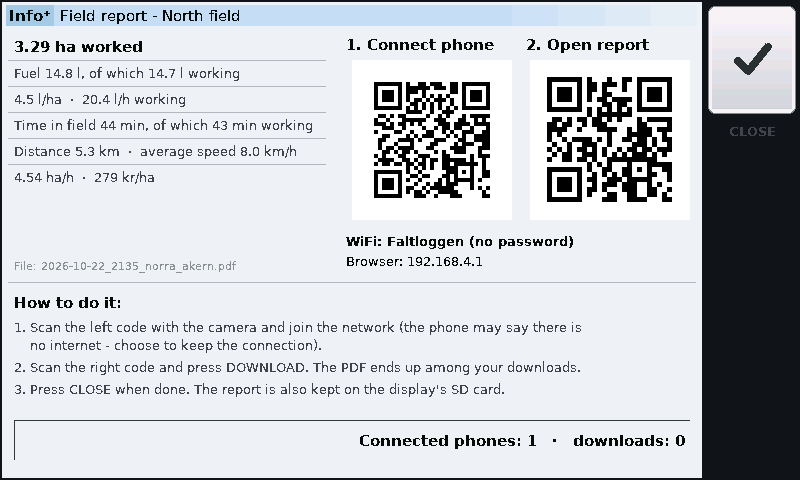

## The field report (PDF)

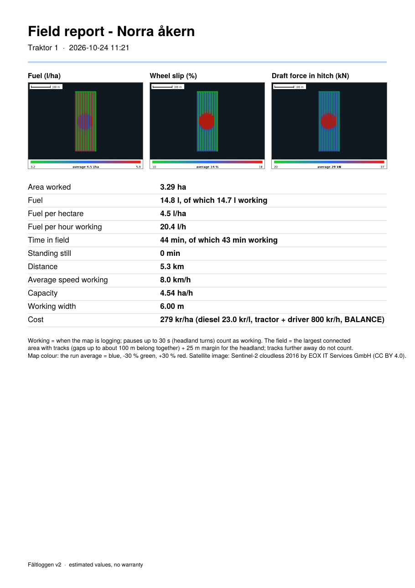

## Implement page

The ISOBUS implement's values with its own names and units.

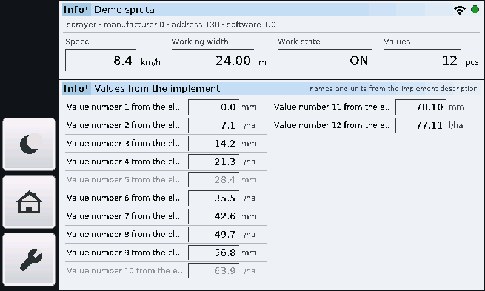

## Settings

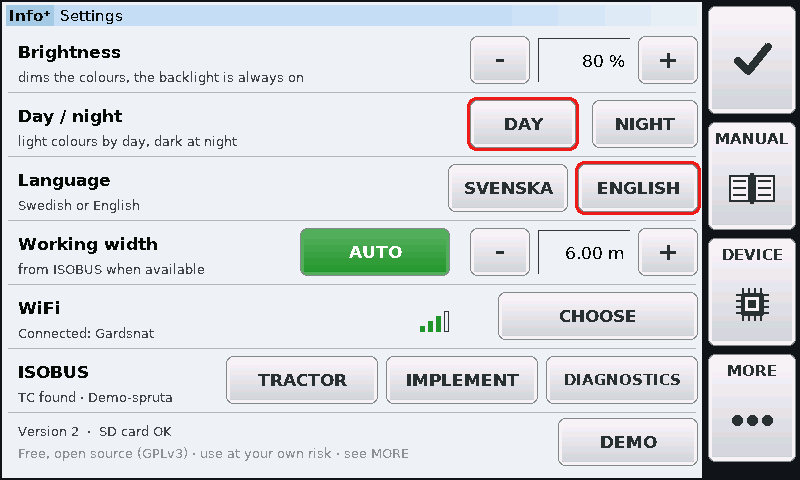

## Settings – more

Updates, logging, feedback and licences.

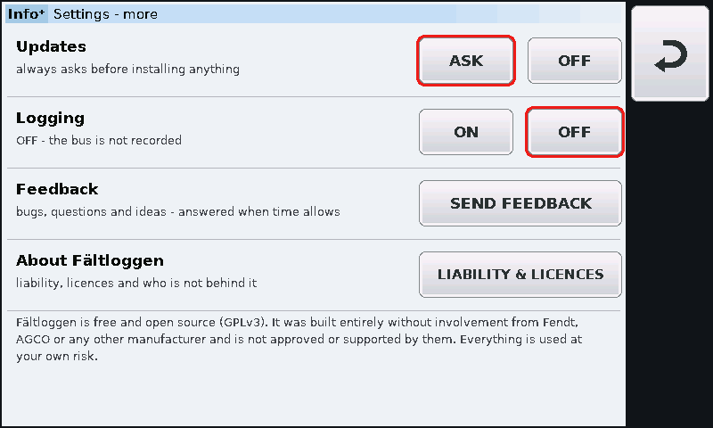

## Feedback

QR code to the GitHub issues page.

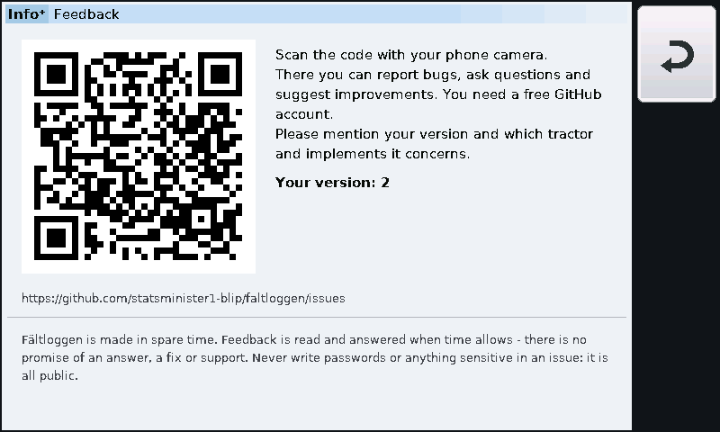

## Update offer

Nothing is installed without YES. TURN OFF disables updates completely.

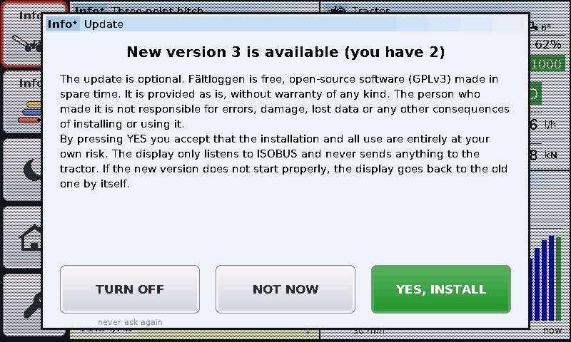

## Built-in manual

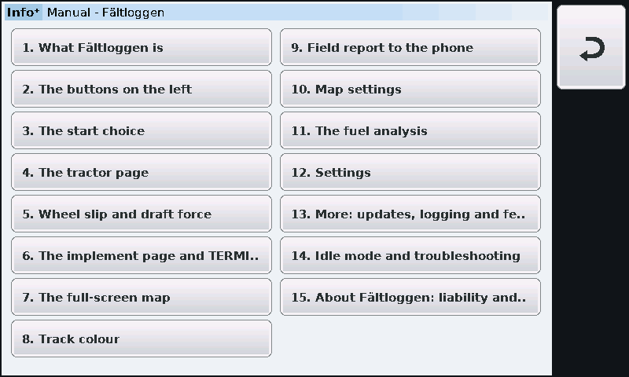

## A manual chapter

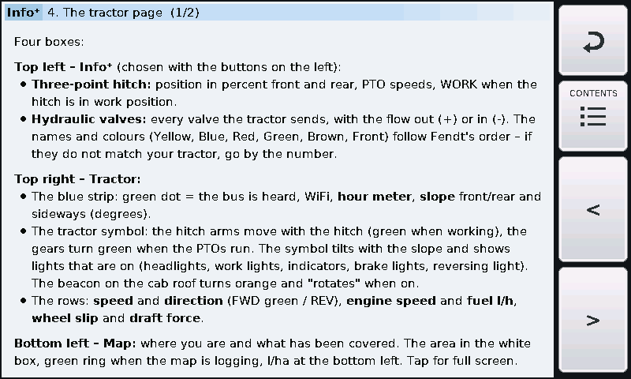

## WiFi

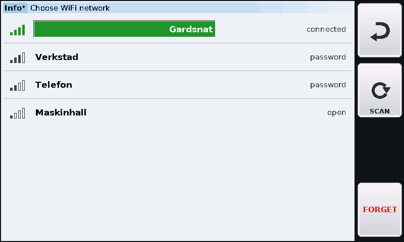

## Device info

Temperature, memory, SD card, network and bus.

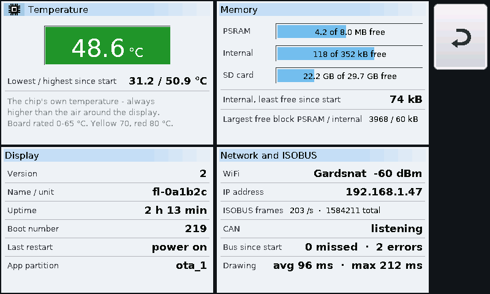

## ISOBUS diagnostics

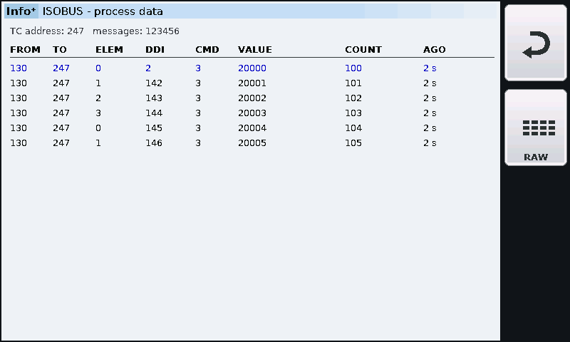
