# Fältloggen – skärmbilder

*English: [SCREENSHOTS.md](SCREENSHOTS.md)*

Alla bilder är ritade av skärmens egen ritkod på en dator (`tools/vt/pc`), med påhittade värden. Terminalspeglingen (TERMINAL) visas inte, eftersom den visar redskapstillverkarens egen grafik.

## Startbilden

Visas några sekunder när skärmen startar.

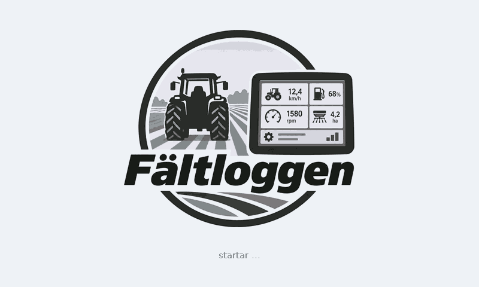

## Viloläge

När inget hörs på ISOBUS. Skiftnyckeln uppe till höger öppnar inställningarna.

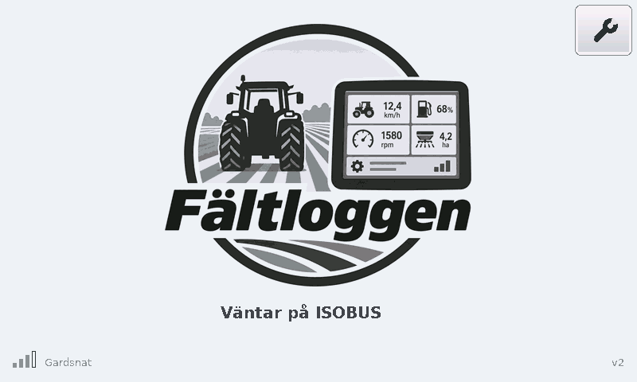

## Startvalet

När ett ISOBUS-redskap hittas får du välja traktor- eller redskapssidan.

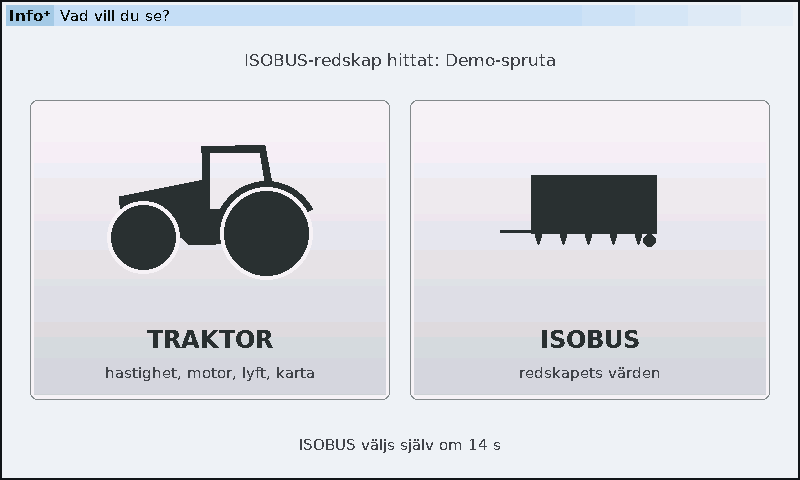

## Traktorsidan

Lyft, kraftuttag, ventiler, hastighet, varv, bränsle, slirning, dragkraft och karta.

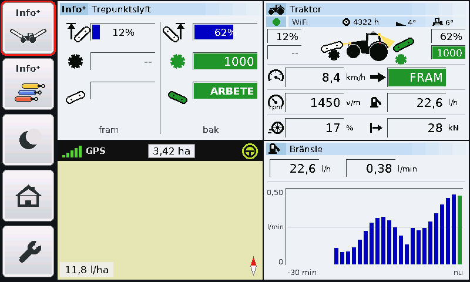

## Traktorsidan i nattläge

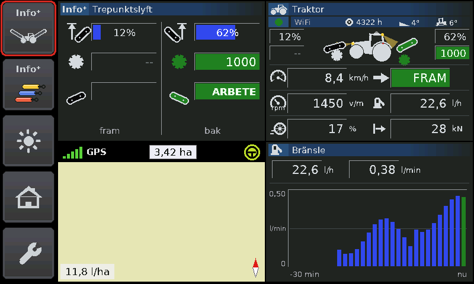

## Kartan i helskärm

Körd yta, areal, bränsle per hektar och spåret färgat efter bränsle, dragkraft eller slirning. (Här utan satellitbild.)

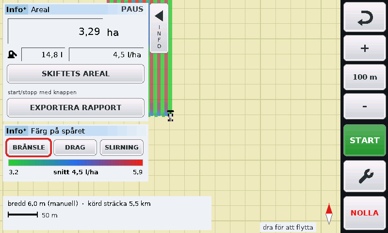

## Kartan med panelerna undanskjutna

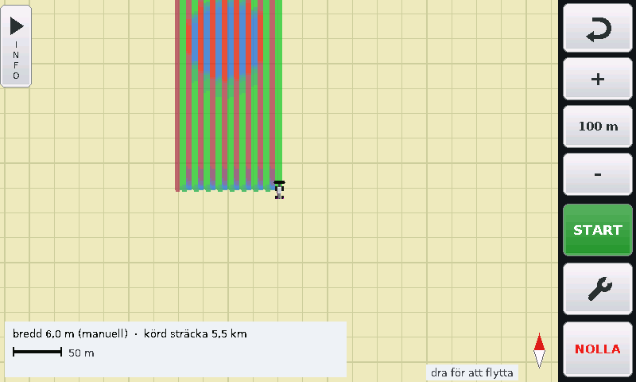

## Kartans inställningar

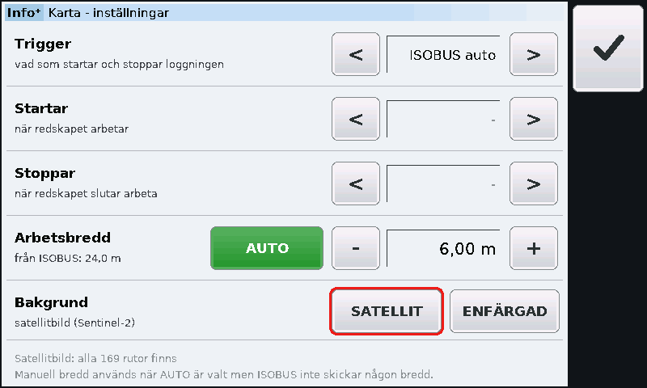

## Bränsleanalys

Kostnad per hektar vid olika hastighet de senaste 30 minuterna, med rekommendation.

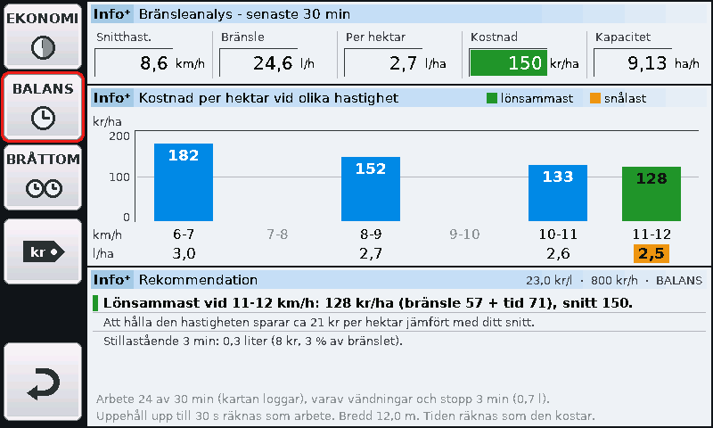

## Fältrapport till telefonen

Telefonen ansluter till skärmens eget WiFi och hämtar rapporten – inget internet behövs.

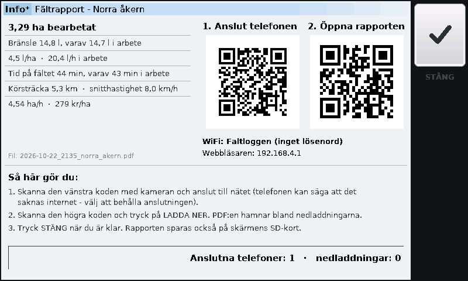

## Fältrapporten (PDF)

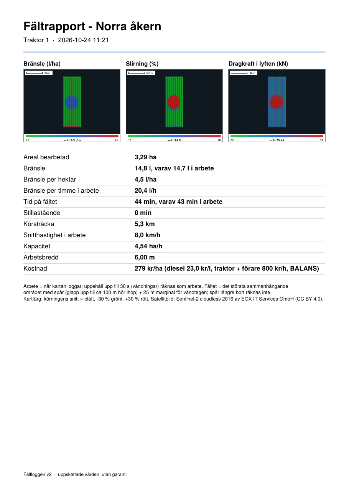

## Redskapssidan

Värdena från ISOBUS-redskapet med redskapets egna namn och enheter.

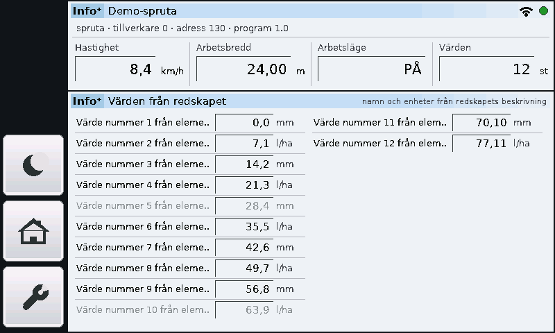

## Inställningar

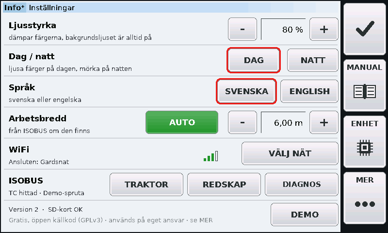

## Inställningar – mer

Uppdateringar, loggning, feedback och licenser.

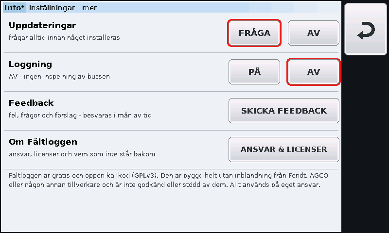

## Feedback

QR-kod till ärendesidan på GitHub.

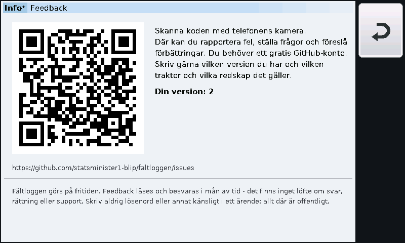

## Erbjudande om uppdatering

Ingenting installeras utan JA. STÄNG AV stänger av uppdateringarna helt.

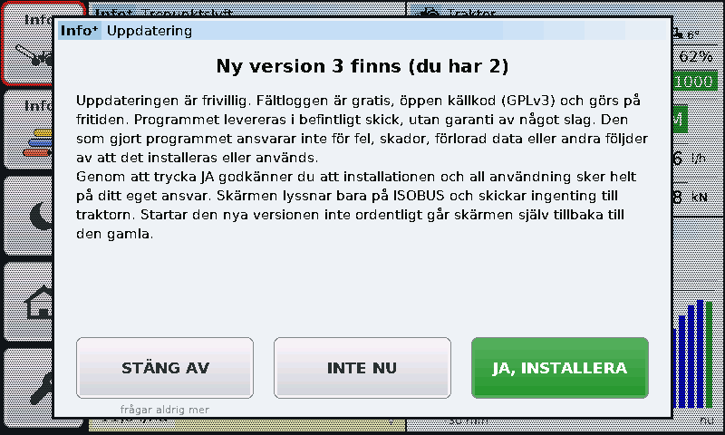

## Inbyggd manual

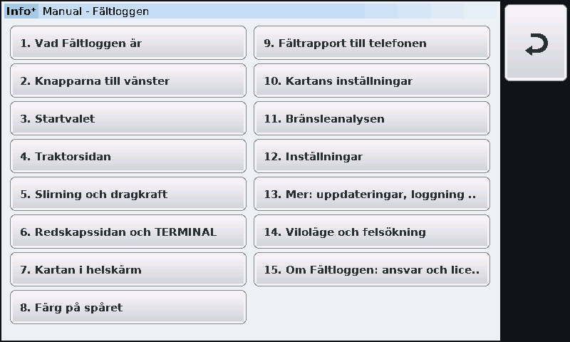

## Ett kapitel i manualen

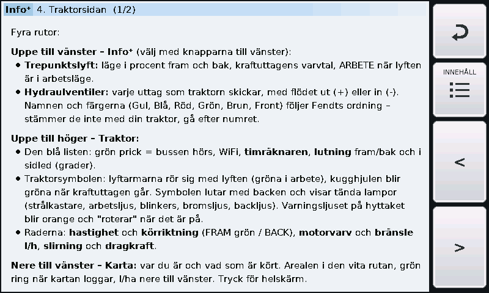

## WiFi

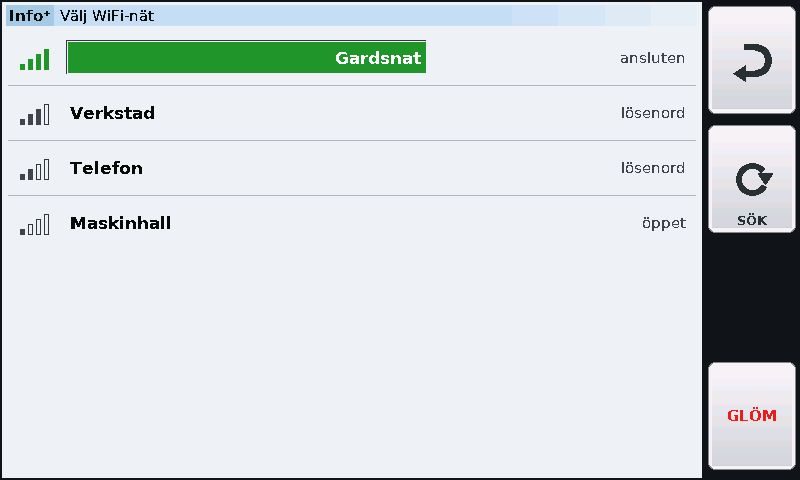

## Enhetsinfo

Temperatur, minne, SD-kort, nät och buss.

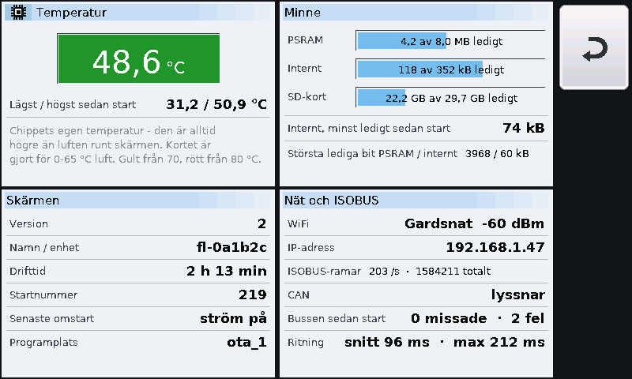

## ISOBUS-diagnos

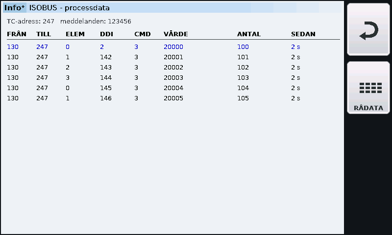
